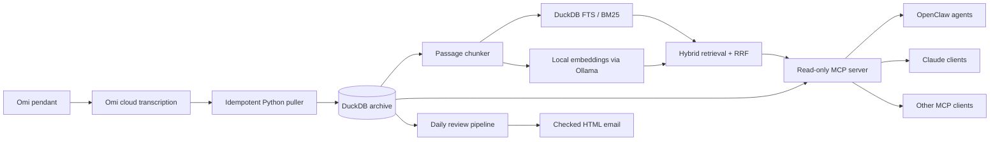

Over the last two days, I turned an Omi pendant from a closed-loop wearable into the capture layer for a local AI system I control.

The pendant is good at one important job: recording the conversations happening around me and sending them to Omi for transcription. But capture is only the beginning. I wanted to search across every transcript, inspect the raw data, generate better summaries, verify extracted action items, and let multiple AI clients work against one consistent archive. I also wanted the system to remain useful if I changed assistants later.

That led to a simple principle:

> Buy the gadget, but keep control of the data and the intelligence built on top of it.

In roughly a day, the system went from an API experiment to a local archive containing 199 conversations, 7,314 transcript segments, 65,379 words, and 578 searchable passages. The ingestion pipeline is idempotent, the query layer is read-only, the search stack runs locally, and a scheduled daily review is ready for its first timer-driven run.

This post explains the architecture, the ugly data-quality findings, and the engineering decisions that made the archive useful.

## The architecture

The system separates capture, storage, retrieval, and synthesis:

Omi remains the capture and transcription provider. Everything after that runs on machines I control:

- A cursor-paginated Python importer pulls conversations from Omi with a 72-hour overlap window.
- DuckDB stores normalized conversations, transcript segments, action items, passages, embeddings, and sync history.
- DuckDB FTS provides BM25 retrieval, while a local embedding model generates vectors without sending transcript text to another embedding API.
- A read-only MCP server exposes status, search, conversation retrieval, and constrained SQL.
- OpenClaw and other MCP-capable clients use the same archive.
- A separate review pipeline produces a daily HTML digest and checks proposed action items against source transcript lines.

This is intentionally not a “give an agent unrestricted access to my computer” design. The archive server exposes a narrow read-only surface, and its SQL endpoint accepts only `SELECT` queries.

## Step 1: Build an idempotent local archive

The first task was getting the raw data out of the app and into a database designed for analysis.

I wrote a Python puller that reads from Omi and writes into four main DuckDB tables:

- `conversations`: timestamps, duration, Omi title, category, overview, language, and source metadata
- `segments`: individual transcript spans with start/end offsets and speaker labels
- `action_items`: Omi-generated tasks, when present
- `sync_runs`: run time, mode, fetched records, newly inserted conversations, errors, and duration

The importer follows Omi’s cursor pagination until it has fetched the complete rolling window. It uses stable conversation IDs as its identity boundary, so a sync can safely refetch the previous 72 hours without creating duplicates.

The order of operations matters. Network fetching finishes before the process takes DuckDB’s write lock. The short database phase then performs delete-then-insert upserts for each conversation and its dependent records in a transaction. A slow API response therefore does not hold the local writer lock, while a failed write cannot leave a partially replaced conversation. Retries become boring, which is exactly what an ingestion system should be.

The initial backfill imported 154 conversations, roughly 5,800 segments, and 51,000 words in 59 seconds with zero errors. Running it again produced no duplicate conversations. Later incremental syncs added only newly observed records. By the latest snapshot, the archive had grown to:

- 199 conversations
- 7,314 segments
- 65,379 words
- 578 passages
- zero errors in the most recent sync

The sync log makes the idempotency and incremental behavior visible:

| Run | Mode | Fetched | New | Errors | Runtime | Passages after run |
|---|---:|---:|---:|---:|---:|---:|
| Initial load | Backfill | 154 | 154 | 0 | 58.6 s | — |
| Immediate rerun | 72-hour overlap | 154 | 0 | 0 | 59.8 s | — |
| Incremental | 72-hour overlap | 157 | 3 | 0 | 70.6 s | 454 |
| Incremental | 72-hour overlap | 163 | 7 | 0 | 72.5 s | 458 |
| Incremental | 72-hour overlap | 193 | 30 | 0 | 80.1 s | 556 |
| Latest snapshot | 72-hour overlap | 198 | 5 | 0 | 87.9 s | 578 |

The runtime increases gradually because the rolling window is refetched for safety. Stable IDs keep the database duplicate-free, while MD5-keyed passage caching prevents unchanged text from being re-embedded.

A systemd timer now invokes the incremental pull every three hours. The timer is deliberately independent of the AI layer: collecting data should not depend on a model being available, funded, or logged in.

## Step 2: Discover that “speaker identity” is not identity

The biggest problem was not ingestion. It was attribution.

Omi assigns speaker IDs, but those IDs are not stable enough to treat as people. A later query against the complete snapshot found a median of 9 distinct speaker IDs per conversation and a maximum of 319. Eleven conversations had empty transcripts. Omi’s action-item collection was empty across the dataset.

Those numbers changed the design.

I do not treat `speaker_id` as a durable person identifier. The archive preserves it because it may still help within a narrow transcript, but downstream systems cannot safely say “Jason promised to do X” merely because a segment has a particular label. Any generated to-do must be checked against the underlying words and surrounding context.

This mattered immediately. The first daily-review draft produced eight bloated action items. A tighter extraction prompt reduced that to three, but two items attributed to me had actually been spoken by someone else. The language model had produced plausible tasks while inheriting bad assumptions from unreliable speaker metadata.

The lesson is broader than Omi: transcription confidence and identity confidence are separate problems. A clean sentence does not imply a correctly identified speaker.

## Step 3: Chunk transcripts for retrieval

Searching full conversations directly is too coarse. Many recordings contain multiple unrelated topics, and most are short—the median is roughly four minutes—but longer conversations can drift substantially.

I split transcripts into passages of about 180 words, with a new chunk forced when there is a gap of roughly 45 seconds. This gives the retrieval system units that are large enough to preserve context but small enough to rank meaningfully.

Each passage keeps a reference to its conversation and source offsets. Search results can therefore lead back to the exact conversation rather than becoming detached summaries.

The initial embedding pass processed 451 passages in about 32 seconds using `nomic-embed-text` through a local Ollama instance on CPU. Each passage is keyed by an MD5 digest of its normalized content. On later runs, unchanged digests reuse their stored vectors and only new or changed passages are embedded. As the archive grew, the passage count reached 578 without requiring a full re-embedding pass.

Keeping embedding local was important: these transcripts can include family members and bystanders, so reducing unnecessary data movement is part of the architecture, not an afterthought.

## Step 4: Combine keyword and semantic search

Speech-to-text data is hostile to exact matching. Product names get split, homophones appear, and punctuation is inconsistent. A concrete example: the transcript may contain “open claw,” while I search for “OpenClaw.”

A keyword-only search for `openclaw` returned zero hits. Semantic retrieval found five relevant passages because it recognized the meaning despite the spelling difference.

Semantic search alone is not enough, though. Vector similarity always returns the nearest result, even when every result is bad. That means an apparently confident result list can be generated for a topic that never occurred.

I implemented three retrieval modes:

| Mode | Strength | Weakness |
|---|---|---|
| Keyword / BM25 | Precise for names, numbers, and exact phrases | Misses transcription variants such as “open claw” |
| Semantic | Handles paraphrases and speech-to-text spelling drift | Always returns a nearest neighbor, even when irrelevant |
| Hybrid | Balances exact evidence with conceptual similarity | Requires tuning and still needs a relevance threshold |

Hybrid mode runs DuckDB FTS/BM25 and vector retrieval independently, then merges the rankings with reciprocal-rank fusion. RRF is useful here because the two systems produce scores on different scales; combining ranks is more robust than pretending BM25 scores and cosine similarity are directly comparable.

The known remaining flaw is rejection. The system can rank candidates, but it still needs a better “none of these are relevant” threshold. That will require a small evaluation set built from real archive queries, including deliberately unanswerable ones.

## Step 5: Put a read-only MCP boundary around it

Once storage and search worked, I needed one interface that different assistants could share.

The MCP server exposes five core operations:

- `archive_status`: archive size, date range, and last synchronization result
- `search`: keyword, semantic, or hybrid passage retrieval
- `list_conversations`: paginated metadata over a date range
- `get_conversation`: one conversation with metadata and optionally bounded transcript segments
- `query_sql`: read-only `SELECT` access for analysis that does not fit a fixed endpoint

The MCP process runs next to the archive. The office OpenClaw instance invokes it locally. Mac OpenClaw, Claude Code, and Claude Desktop launch it through an authenticated SSH path, while a Codex client is configured but not yet proven. All of them use the same archive without copying the database to each machine.

I explicitly avoided a design that would expose the archive through a public tunnel. Omi’s own app and summaries remain useful as the capture-side experience, and OmiClaw demonstrates a convenient bridge from Omi into OpenClaw, but its public-tunnel approach did not match my threat model. A wearable transcript archive is unusually sensitive: it may contain other people, incidental speech, location context, and conversations nobody intended to publish. Convenience is not worth turning that dataset into a public network service.

One operational gotcha cost time: the Gateway keeps a long-lived MCP server process. Editing the server code does not necessarily replace the already-running process, so the client may continue receiving responses from stale code. After a server change, I have to restart that process—or the Gateway lifecycle that owns it—before validating the update.

That is the sort of problem that looks like a bad patch until you realize the new code was never loaded.

## Step 6: Generate a daily review—and verify it

The archive is most useful when it turns a day of ambient conversation into something reviewable. I built a daily pipeline that:

1. Pulls the day’s conversations from DuckDB.
2. Groups transcript material into chunks of roughly 80 KB.
3. Uses a model to summarize each chunk.
4. Combines those summaries into a structured daily review.
5. Runs a second model pass over every proposed to-do.
6. Checks the task against the transcript lines from which it supposedly came.
7. Produces an HTML email for delivery at 6:45 each morning.

The verification pass is not decorative. On the first checked run it made 16 corrections. That validated the idea but also exposed its limits: the checker currently verifies to-dos, not every claim in the narrative sections. A checked run also costs roughly 100,000 model tokens, so there is an obvious optimization problem ahead.

The scheduled morning run has not fired yet. The pipeline works when invoked manually, but I will not call an automation “working” until the timer has executed it successfully and the result has been delivered. Configuration is not proof.

## The agent infrastructure needed maintenance too

This project also exposed weaknesses in the surrounding agent setup.

One scheduled development digest had been failing because every model in its fallback chain was unusable for a different reason: one API account had exhausted its credits, one CLI login was absent, and another configured model was not supported by the account serving it. I moved active work away from that broken chain and pruned obsolete scheduled jobs.

On another machine, an OpenClaw update was blocked by two empty session files. Those files were quarantined rather than destroyed, the migration was rerun, and the system was brought back onto a working model configuration.

These side quests reinforced the same architectural point as the Omi archive: durable automation needs explicit state, observable failures, and recovery paths that do not rely on a single model provider.

## What I would change next

The current system is useful, but it is not finished.

### 1. Add relevance rejection

Hybrid retrieval needs a calibrated threshold so the server can return “no relevant result” rather than a weak nearest neighbor.

### 2. Improve speaker attribution

Speaker IDs cannot be trusted globally. A better approach may combine short-range voice embeddings, explicit enrollment, conversational context, and a visible confidence score. Until then, attribution-sensitive output should remain conservative.

### 3. Verify narrative claims

The second-pass checker should expand beyond action items. Dates, decisions, names, and claims about who said what should all be traceable to transcript spans.

### 4. Reduce review cost

A 100,000-token daily review is acceptable for an experiment, not necessarily for a permanent routine. Incremental summaries, deduplication, smaller evidence windows, and selective verification should reduce cost without removing provenance.

### 5. Build a real retrieval evaluation set

I need a set of keyword, paraphrase, misspelling, and no-answer queries with expected passages. Search quality should be measured, not judged from a few satisfying demos.

### 6. Prove the timers

The three-hour importer and 6:45 daily review need observed successful scheduled runs, failure alerts, and freshness checks. A dashboard showing last sync, last review, error count, and archive lag would make silent failure much harder.

## The larger idea

The useful product is not the pendant by itself. It is the pipeline around it.

A wearable can capture audio. A transcription service can turn that audio into text. But the long-term value comes from owning a structured archive, being able to search it with more than one technique, exposing it through a narrow interface, and requiring generated claims to point back to evidence.

The system I built is deliberately replaceable at every layer. I can change the wearable, the transcription provider, the language model, the embedding model, or the assistant without giving up the archive underneath them.

That is what “buy the gadget, keep the data” means in practice: use the hardware for what it does well, then build the memory layer on infrastructure you control.

## Next experiment: custom firmware and phone-free PCM streaming

The next layer I want to explore is the pendant firmware itself. Today, Omi sends PCM audio to its phone app, which makes the phone the required bridge between the microphone and everything downstream. I would like to experiment with custom firmware that lets me choose the destination instead.

For example, the pendant could stream PCM directly to a laptop, a nearby single-board computer, or a dedicated home gateway. That device could handle buffering, voice-activity detection, wake-word processing, local transcription, encryption, or forwarding into the archive—without requiring the Omi app to remain in the middle. A portable receiver could provide the same path away from home, while the phone could remain one optional target rather than the only one.

There are real constraints to test: Bluetooth bandwidth and stability, battery life, reconnection behavior, audio framing, secure pairing, and whether the existing hardware exposes everything needed. But if the experiment works, it would complete the ownership story. I would control not only storage, search, and summarization, but also where the raw audio goes from the moment it leaves the microphone.

---

*Draft based on the first two days of the project. Counts reflect the archive snapshot at 9:30 PM ET on November 21, 2026. Privacy-sensitive transcript content, network names, credentials, and third-party conversations have been intentionally excluded.*
